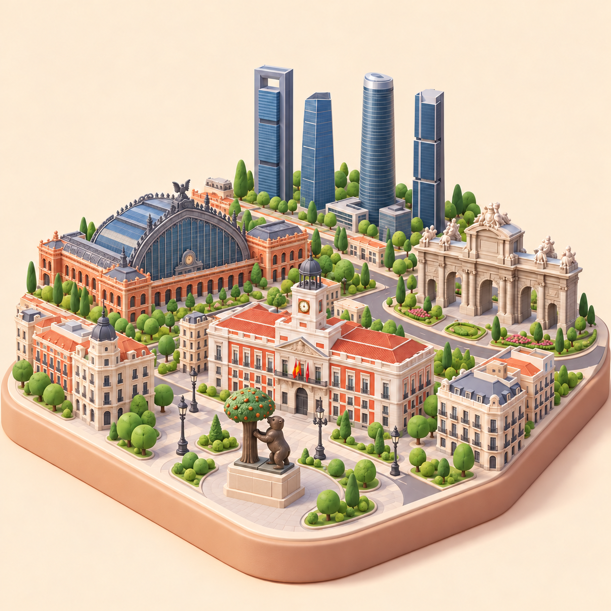
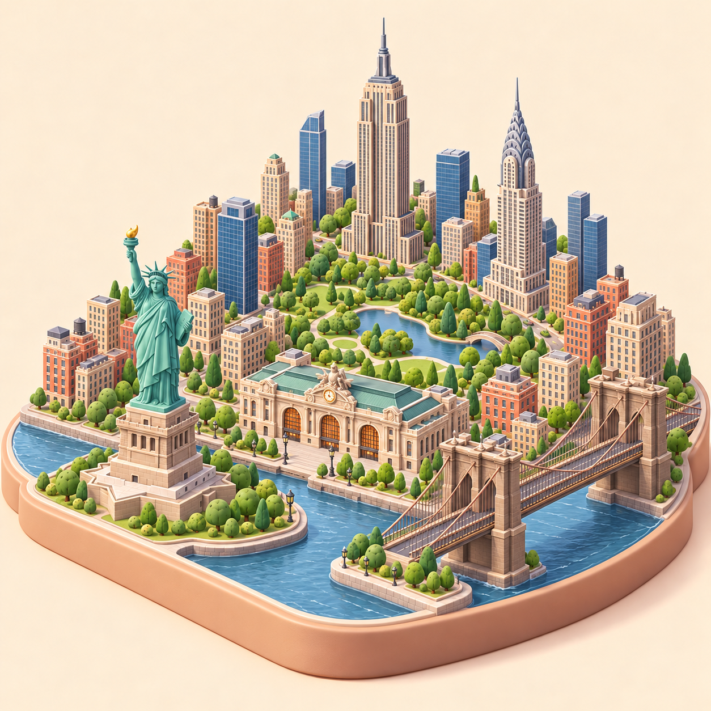
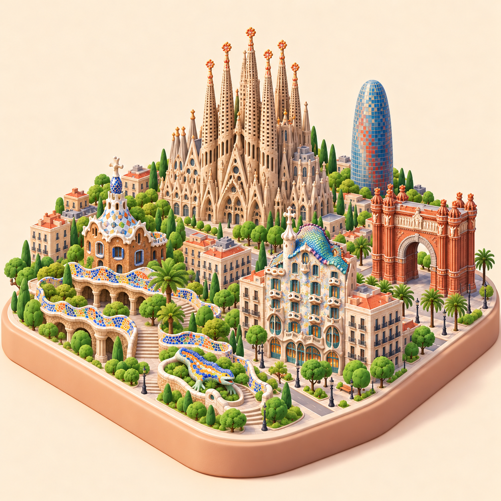
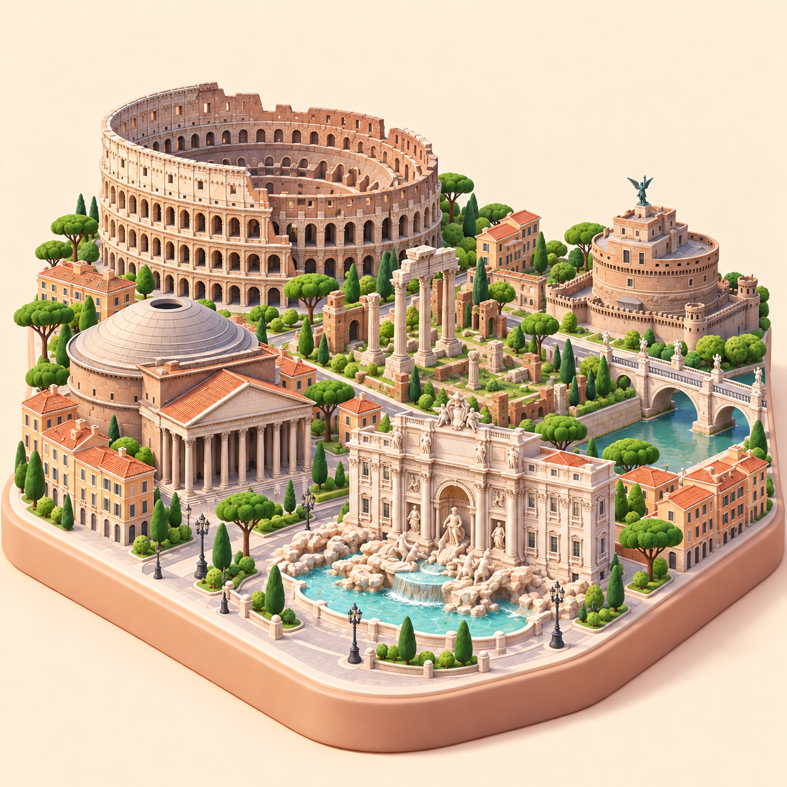
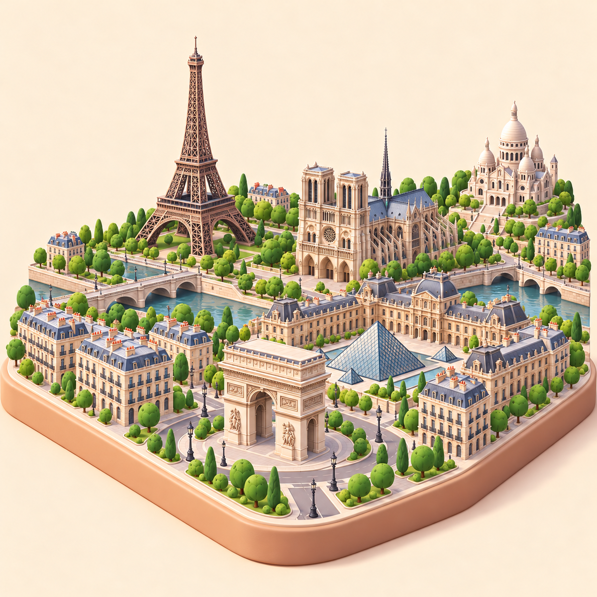
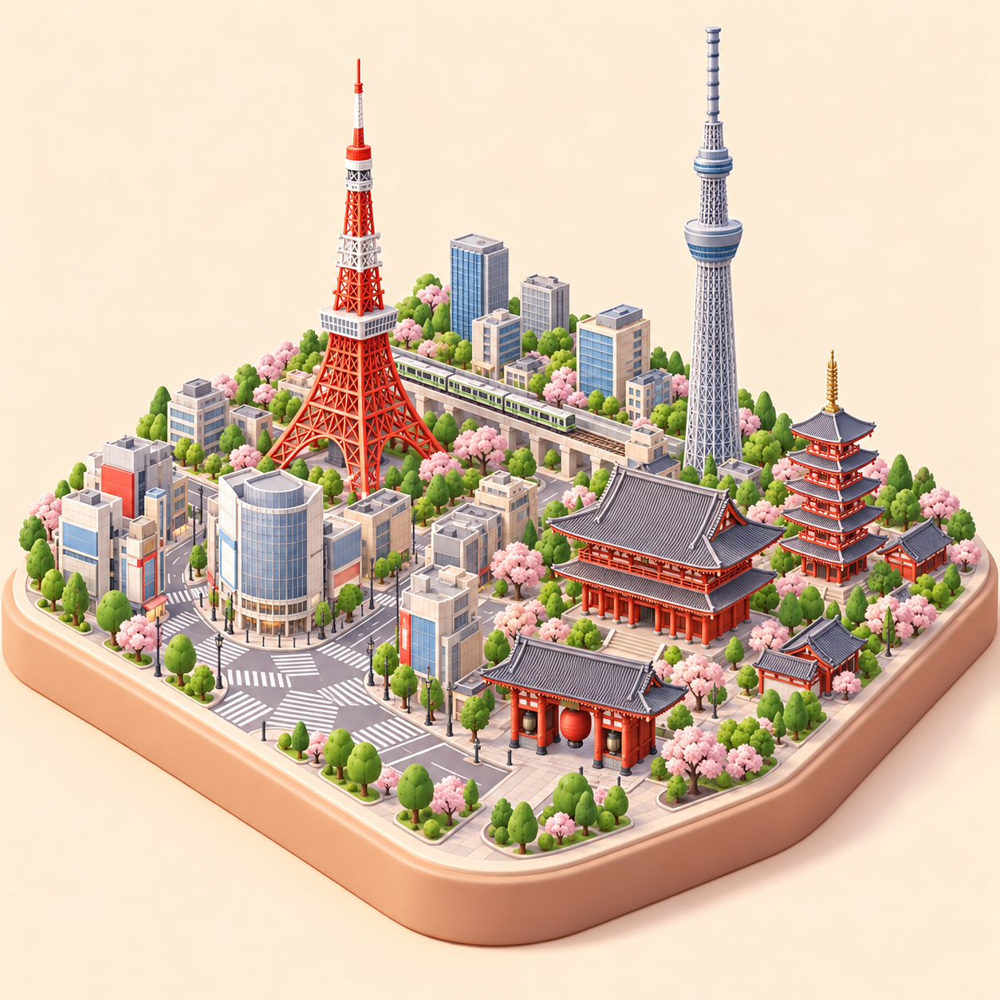

# Galería del piloto de Ciudades

Seis imágenes fijas con aspecto de maqueta 3D. Las cuatro nuevas se han generado con Madrid como referencia de estilo. Los nombres de esta galería sirven para revisión; no están incrustados en las imágenes del juego.

| Madrid | Nueva York |
| --- | --- |
|  |  |
| Barcelona | Roma |
|  |  |
| París | Tokio |
|  |  |

## Revisión visual de la ampliación

Las cuatro nuevas imágenes conservan fondo marfil, plinto beige, vista isométrica, luz cálida y superficies suavizadas. Los hitos principales se distinguen en la vista generada. El objetivo de márgenes libres no se ha conseguido: las bases llegan a los bordes laterales, como en Madrid. Hay detalles de personas diminutas pese a la restricción del prompt. Falta comprobar la legibilidad en una tarjeta real de móvil y la precisión arquitectónica frente a referencias.

| Ciudad | Hitos visibles en el concepto | Revisión pendiente |
| --- | --- | --- |
| Barcelona | Sagrada Familia, Park Güell con salamandra y banco, Casa Batlló, Torre Glòries, Arco de Triunfo | Silueta y distribución de torres de la Sagrada Familia; fachada y cubierta de Casa Batlló; mosaicos; márgenes. |
| Roma | Coliseo, Panteón, Fontana di Trevi, ruinas del Foro, Castel Sant'Angelo | Proporciones del Coliseo y el Panteón; esculturas de Trevi; retirar personas; márgenes. |
| París | Torre Eiffel, Notre-Dame, Louvre y pirámides, Arco de Triunfo, Sacré-Cœur | Proporciones y disposición de fachadas; estructura de la Torre Eiffel; retirar personas; márgenes. |
| Tokio | Tokyo Tower, Skytree, Sensō-ji y pagoda, Kaminarimon, cruce de Shibuya y tren | Siluetas y proporciones de torres y templo; composición del cruce; retirar personas; márgenes y espacio sobre la antena. |

Estado de las seis imágenes: **concepto pendiente de revisión**, no recurso final aprobado. Las versiones nuevas no modifican las imágenes iniciales ni activan el modo en la app.

Los prompts completos están en [prompts.md](prompts.md); el plan de producción, en [README.md](README.md).
